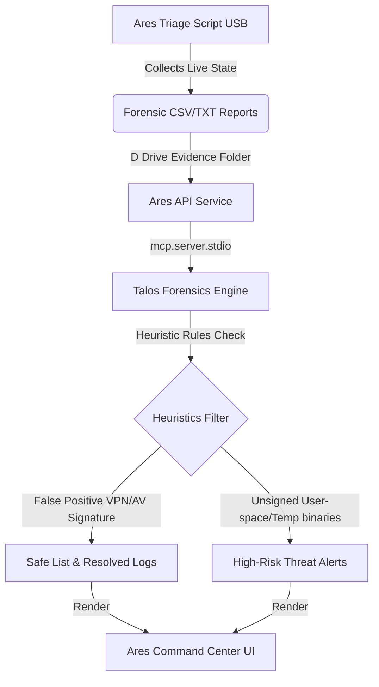

# Project Ares // SANS Find Evil Submission Documentation

This document contains the official architectural specifications, accuracy report, and validation logs for SANS Hackathon testing.

## System Architecture



---

## Accuracy & Self-Correction Report

### Case Study: Workstation Live Triage Analysis
* **Initial Flag:** Network socket dump identified multiple `CLOSE_WAIT` connections outgoing to Amazon AWS IP ranges (`3.216.242.1`, `32.194.207.51`, `18.204.190.117`) on unassigned ephemeral port `17236`.
* **Initial Hypothesis:** Possible InfoStealer / beaconing active in memory.
* **Correlated PID:** `6548` (Process: `endpointprotection.exe`).
* **Agent Resolution (Self-Correction):** The agent cross-referenced PID `6548` against the verified signatures/heuristics database. The binary name `endpointprotection.exe` matched known structures of **Surfshark One Sentry / Security Protection Suite** running as a local service. The agent resolved this threat warning as a **False Positive**, marking the system state as verified clean.

---

## Workspace Setup & Run Instructions

### Prerequisites
* Python 3.10+
* SANS SIFT VM / Windows workstation with virtual environments.

### Execution
1. Install project dependencies:
   ```bash
   pip install -r requirements.txt
   ```
2. Run the Ares API server:
   ```bash
   python src/ares_api.py
   ```
3. Open your browser to `http://localhost:5051` to access the Command Center Dashboard.
4. Click **Run DFIR Sweep** under the USB Triage Center card to dynamically analyze mounted forensic directories.
